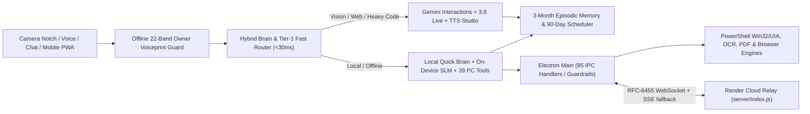

# JEEVA AI — Hybrid Local + Cloud Windows & Mobile AI Assistant

**Website:** [https://webbuildix.online/](https://webbuildix.online/) · **Cloud Relay:** [https://jeeva-ai-mjr1.onrender.com/](https://jeeva-ai-mjr1.onrender.com/) · **Created by:** Roushan Kumar (WebBuildix)

JEEVA AI is a low-footprint, local-first Windows desktop AI assistant built with **Electron**, **React + Vite**, **PowerShell Win32/UIA automation**, and **Gemini AI** (`@google/genai`), paired with a **Render HTTPS/WebSocket Relay** so you can control your PC from your desktop Camera Notch or mobile browser.

---

## Architecture Overview



---

## Core Features

### 1. Hybrid Local Brain & Zero-API Command Lock
- **Local-First Execution**: Everyday PC commands (app launch, typing, shortcuts, volume/brightness, file search, reminders, digital PDFs) run locally in `<30ms` with **0 Gemini API cost**.
- **Optional On-Device SLM**: Supports local Qwen 2.5 / Gemma 3 models tuned to your hardware.
- **Smart Auto-Switch**: Escalates to Gemini Cloud only for complex reasoning, visual screen inspection, live web search, or heavy coding.
- **1-Click API Setup**: Onboarding and Settings include auto-filled Render Cloud URL (`https://jeeva-ai-mjr1.onrender.com/`) and a direct **Create Gemini API Key** button (`https://aistudio.google.com/apikey`).

### 2. Realistic Human Studio Voices & Own Voice Cloning
- **4 Human Voice Personas**: `Natural Warm (Human)`, `Calm Executive (Male)`, `Crisp Studio (Female)`, and `Friendly Conversational` powered by `gemini-3.8-flash-lite-tts` / `gemini-3.8-flash-tts` with sentence-level streaming prefetch and Indian English / Hindi / Hinglish prosody.
- **Clone Your Own Voice**: Record a 10–25s voice sample + 5s consent audio directly inside **Settings → Voice & Audio** (16kHz Mono WAV via `src/services/wavRecorder.js`) to create and activate your personal cloned voice (`ai.voices.create`).
- **Offline Natural Fallback**: Prioritizes OS `Natural`/`Neural`/`Google` voices when offline or before an API key is added.

### 3. Offline 22-Band Owner Voiceprint Protection
- **100% Offline Biometric Guard** (`src/services/speakerVerify.js`): 20 Mel-scale spectral bands + spectral tilt + Pitch (F0) + Zero-Crossing Rate (ZCR) + 3-sample multi-exemplar matching — works without internet or Gemini API.
- **Hard Command Gate**: Automatically blocks voice commands from unauthorized speakers before execution while keeping typed Dashboard/Chat accessible to the owner.
- **3 Security Levels & Live Tester**: `Relaxed (66%)`, `Balanced (73% · Recommended)`, and `Strict (80%)` with an interactive **Test Match %** button in Settings.

### 4. Camera Notch Dynamic Island & Low-End Optimization
- **Camera Notch UI**: Starts quietly in lightweight standby near your top camera bezel; hover to reveal **Mic**, **Inline Quick Chat** (send commands without opening the full window), **Full Chat**, and **PC Dashboard** controls.
- **Start with Windows**: Can be enabled directly during initial Onboarding or toggled anytime in Settings.

### 5. 90-Day Smart Scheduler, 3-Month Voice History & Full PC Control
- **Smart Reminders & Missed Catch-Up**: Schedule tasks up to 90 days ahead by voice (e.g., *"5 December ko shaam 6 baje meeting yaad dilana"*). Alerts 30 minutes early and automatically surfaces missed tasks when your PC powers back on.
- **3-Month Date-Indexed Episodic Memory**: Full voice & command history searchable by natural date queries (*"Kal maine kya bola tha?"*).
- **39 PC Tools & Multi-App Automation**: Full hands-free control over **VS Code**, **GitHub**, **Chrome**, **YouTube**, **Offline PDF Voice Reading & Summarization** (Indian-style voice), and **Windows OCR** screen reading/clicking.
- **Security Guardrails**: Protects `C:\Windows\System32`, critical registry hives, `.env`, `.ssh`/`.vault`, and browser credential stores (`Login Data`), with granular session/app permissions.

---

## Setup & Development

1. **Install dependencies**:
   ```bash
   cd jeeva-ai
   npm install
   ```
2. **Configure environment variables**:
   Copy `.env.example` to `.env` and fill in your values (never commit `.env`).
3. **Run automated test suite (syntax, 39 tools, 85 IPC handlers, voiceprint, SEO, PS AST)**:
   ```bash
   npm test
   ```
4. **Build production frontend (`dist/`)**:
   ```bash
   npm run build
   ```
5. **Run desktop app in dev mode**:
   ```bash
   npm run dev
   ```
6. **Build Windows NSIS Installer (`release/JEEVA AI Setup 1.0.0.exe`)**:
   ```bash
   npx electron-builder --win nsis --publish never
   ```

---

## SEO & Web Deployment (`webbuildix.online`)
- `index.html`: Canonical URL (`https://webbuildix.online/`), Open Graph, Twitter Card, and JSON-LD `WebSite` + `SoftwareApplication` structured data.
- `public/robots.txt` & `public/sitemap.xml`: Configured for search engine indexing (served with proper `text/plain` and `application/xml` MIME headers by `server/index.js`).
- `public/icon.svg`: Modern geometric JEEVA AI vector emblem & favicon.

### Security deployment notes
- Configure a persistent Render DATA_DIR; otherwise the automatically generated session secret may be lost when the host is replaced.
- Set INSTALLER_SHA256 to the 64-character SHA-256 digest of the exact release installer. Updates without HTTPS and a valid digest are intentionally blocked.
- Read-only guest shares currently expose battery status only; process, file, clipboard, Wi-Fi, diagnostics, and scheduler data remain owner-only.
- The desktop bridge binds to localhost unless both JEEVA_BRIDGE_TLS_CERT and JEEVA_BRIDGE_TLS_KEY are configured. To use phone-to-PC LAN control, provide a trusted certificate valid for the LAN hostname/IP, install its issuing CA on the phone, and use an https:// bridge URL.
- Restrict bridge origins with JEEVA_BRIDGE_ALLOWED_ORIGINS when deploying a custom web origin.

---

## Environment Variables (Server & Build)

| Variable | Purpose | Required |
|---|---|---|
| `GEMINI_API_KEY` | Google AI Studio API key for Render proxy & live tokens | Server proxy mode |
| `APP_PIN` | Owner Admin PIN guarding `/api/gemini` & `/api/unlock` | Recommended |
| `RELAY_SECRET` | Optional backend relay secret | Optional |
| `SESSION_SECRET` | HMAC secret for signing owner tokens | Recommended |
| `PRIVATE_LOCK_ALL` | Set `true` to hide guest workspace unless PIN entered | Optional |
| `GEMINI_RPM_LIMIT` | Per-IP rate limit per minute (default `40`) | Optional |
| `DATA_DIR` | Persistent directory for SQLite/JSON relay state | Optional |
| `INSTALLER_DOWNLOAD_URL` | Direct `.exe` download URL advertised by `/api/config` | Optional |
| `INSTALLER_SHA256` | Exact installer SHA-256 digest; updater refuses unpinned installers | Required for updates |
| `TRUST_PROXY` | Trust forwarding headers only behind a trusted proxy | Optional |
| `JEEVA_BRIDGE_TLS_CERT` / `JEEVA_BRIDGE_TLS_KEY` | Certificate/key paths; required for LAN bridge access | Optional |
| `JEEVA_BRIDGE_ALLOWED_ORIGINS` | Comma-separated exact origins permitted to call the local bridge | Optional |
