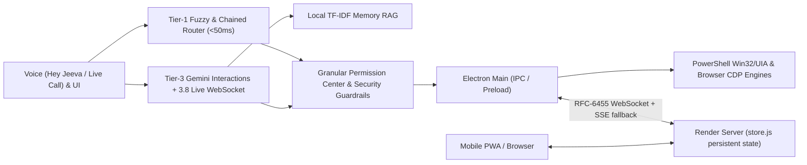

# JEEVA AI — Personal Windows Workstation & Mobile Companion AI

JEEVA AI is a local-first Windows desktop AI assistant built with **Electron**, **React + Vite**, **PowerShell Win32/UIA automation**, and **Gemini AI** (`@google/genai`), paired with a **Render Cloud WebSocket Relay** so you can control your PC safely from your phone.

## Architecture Overview



## Core Features

- **Always-On Voice & 3-Tier Pipeline**:
  - 16 kHz Mono PCM pre-roll ring buffer + Goertzel spectral vocal-band VAD + adaptive silence grace
  - Instant Barge-In (`"Ruk / Stop"`) with TTS ducking & fade-out
  - **Tier 1**: `<50ms` deterministic local router with Hinglish phonetic normalization & multi-action chaining
  - **Tier 2**: Windows `System.Speech` offline wake engine (when OS language pack is installed)
  - **Tier 3**: Full-duplex `gemini-3.8-live` WebSocket bidirectional audio streaming
  - Deictic (`"Isko / Is Error / Yahan"`) foreground window + clipboard + screen capture attachment
  - Acoustic spectral/F0 Speaker Voiceprint Guard for high-risk confirmations
- **PC Automation & Zero-API Control Center**:
  - **PC Control Center (`Ctrl+Shift+M`)**: Clipboard history (20 items), CPU/RAM processes & TCP ports, Timers, **Custom Multi-Step Workflow Builder** (with trigger/condition & dry-run preview), **Searchable Exportable Audit Log**, and **Persistent Local Memory RAG** manager.
  - **Proactive System Watchdog**: Alerts on low battery, low disk space, high RAM, or sustained CPU spikes with 1-click cleanup/power fixes.
- **Security & Trust**:
  - Hardcoded path & command guardrails protecting `C:\Windows\System32`, critical registry hives, `.env`, `.ssh`/`.vault`, and browser credential folders (`Login Data`).
  - Granular permissions: **Deny**, **Allow Once**, **Allow Session**, **Always Allow `<App/Folder>`**, **Always Category**.
  - Voice + Chat dual confirmation cards in English, Hinglish, or Hindi.

## Setup & Development

1. **Install dependencies**:
   ```bash
   cd jeeva-ai
   npm install
   ```
2. **Configure environment variables**:
   Copy `.env.example` to `.env` and fill in your values (never commit `.env`).
3. **Run tests & build web bundle**:
   ```bash
   npm test
   npm run build:react
   ```
4. **Run desktop app in dev mode**:
   ```bash
   npm run dev
   ```
5. **Build Windows NSIS Installer**:
   ```bash
   npx electron-builder --win nsis --publish never
   ```

## Environment Variables (Server & Build)

| Variable | Purpose | Required |
|---|---|---|
| `GEMINI_API_KEY` | Google AI Studio API key for Render proxy & live tokens | Server proxy mode |
| `APP_PIN` | Owner Admin PIN guarding `/api/gemini` & `/api/unlock` | Recommended |
| `RELAY_SECRET` | Optional backend relay secret | Optional |
| `SESSION_SECRET` | HMAC secret for signing owner tokens | Recommended |
| `PRIVATE_LOCK_ALL` | Set `true` to hide guest workspace unless PIN entered | Optional |
| `GEMINI_RPM_LIMIT` | Per-IP rate limit per minute (default `40`) | Optional |
| `DATA_DIR` | Persistent directory for SQLite/JSON relay state | Optional |
| `INSTALLER_DOWNLOAD_URL` | Direct `.exe` download URL advertised by `/api/config` | Optional |
